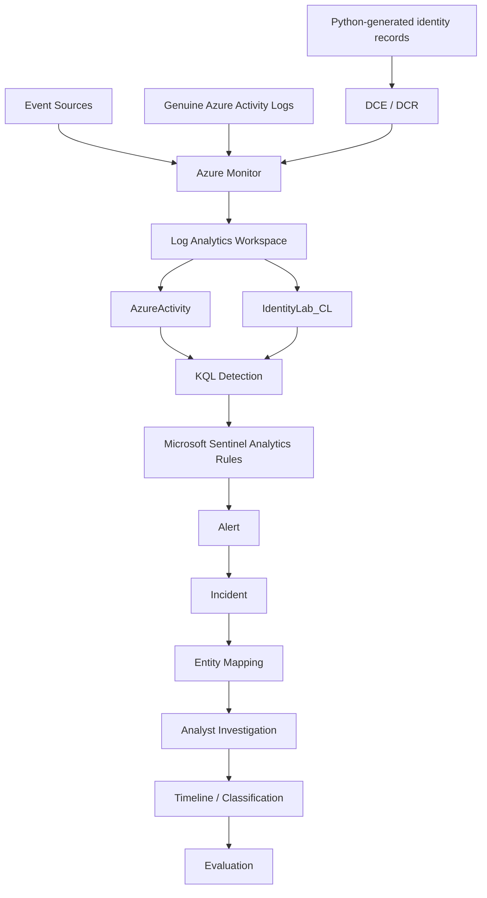

# Azure Sentinel Identity SOC Lab

A controlled Azure-based Security Operations Centre (SOC) project for detecting and investigating identity-focused attack patterns with **Microsoft Sentinel, Log Analytics, KQL, Azure Monitor and Python**.

This repository is a portfolio version of my MSc Computer Forensics and Cyber Security project. It demonstrates an end-to-end workflow from controlled security telemetry generation to cloud ingestion, detection, Sentinel incident creation and forensic reconstruction.

## Project highlights

- Built a controlled SOC lab using **Microsoft Azure + Microsoft Sentinel**
- Collected **genuine Azure Activity Logs** for authorised control-plane activity
- Generated **18 controlled identity/audit-style records** in Python
- Ingested custom telemetry through **Azure Monitor DCE/DCR** into `IdentityLab_CL`
- Developed and tested **3 KQL detection rules**
- Converted the rules into **Microsoft Sentinel scheduled analytics rules**
- Investigated incidents using mapped account/IP entities
- Reconstructed a chronological forensic identity-event timeline
- Tested both attack scenarios and predefined normal controls

## Detection scenarios

| Scenario | Core detection logic | ATT&CK mapping | Lab result |
|---|---|---|---|
| Password spraying | Multiple failed sign-ins from one IP targeting several users in a 15-minute bin | T1110.003 | Expected detection produced |
| Rapid location change | Same user, successful sign-ins from different countries within 60 minutes | T1078.004 | Expected detection produced |
| Privilege escalation | Successful, unapproved assignment of a high-impact admin role | T1098.003 | Expected detection produced |

The normal-control dataset produced **zero detections across all three rules** in the controlled evaluation.

## Architecture



## Repository structure

```text
azure-sentinel-identity-soc-lab/
├── data/
│   ├── all_identity_events.json
│   ├── normal_activity.json
│   ├── password_spray.json
│   ├── privilege_escalation.json
│   └── suspicious_signin.json
├── kql/
│   ├── password_spraying.kql
│   ├── rapid_location_change.kql
│   ├── privilege_escalation.kql
│   ├── normal_activity_false_positive.kql
│   ├── combined_detection.kql
│   ├── incident_lifecycle.kql
│   ├── forensic_identity_timeline.kql
│   └── evidence_completeness.kql
├── python/
│   ├── generate_identity_logs.py
│   ├── send_logs_to_azure.py
│   └── test_python.py
├── docs/
│   └── project_notes.md
├── .gitignore
├── SECURITY.md
├── requirements.txt
└── README.md
```

## Quick start

### 1. Create a Python environment

```bash
python -m venv .venv
```

Windows PowerShell:

```powershell
.\.venv\Scripts\Activate.ps1
```

Install dependencies:

```bash
pip install -r requirements.txt
```

### 2. Test Python

```bash
python python/test_python.py
```

### 3. Generate the controlled dataset

```bash
python python/generate_identity_logs.py
```

This creates the five JSON files in `data/`, including the combined 18-record dataset.

### 4. Authenticate to Azure

```bash
az login
```

The uploader uses `AzureCliCredential`, so credentials are **not embedded in the source code**.

### 5. Configure required Azure values

The upload script expects these environment variables:

```text
AZURE_LOGS_ENDPOINT
AZURE_DCR_IMMUTABLE_ID
AZURE_STREAM_NAME
```

Example in PowerShell:

```powershell
$env:AZURE_LOGS_ENDPOINT="<your-dce-logs-ingestion-endpoint>"
$env:AZURE_DCR_IMMUTABLE_ID="<your-dcr-immutable-id>"
$env:AZURE_STREAM_NAME="<your-custom-stream-name>"
```

### 6. Upload the records

```bash
python python/send_logs_to_azure.py
```

The destination used by the project was the custom Log Analytics table:

```text
IdentityLab_CL
```

## KQL detections

The `kql/` directory contains the three primary detection queries plus evaluation queries used for:

- normal-control testing
- combined detection evaluation
- incident lifecycle analysis
- forensic timeline reconstruction
- evidence completeness assessment

## Controlled evaluation

The project used a small predefined dataset rather than claiming production-scale accuracy.

| Test | Expected | Observed |
|---|---:|---:|
| Password-spraying attack | 1 | 1 |
| Password-spraying normal control | 0 | 0 |
| Rapid-location-change attack | 1 | 1 |
| Rapid-location-change normal control | 0 | 0 |
| Privilege-escalation attack | 1 | 1 |
| Privilege-escalation normal control | 0 | 0 |

**6/6 predefined controlled expectations passed.**

This result demonstrates that the implemented workflow behaved as designed against the controlled dataset. It is **not** presented as proof of 100% real-world detection accuracy.

## Important implementation notes

### Genuine vs synthetic evidence

The project deliberately separates:

- genuine Azure control-plane telemetry stored in `AzureActivity`
- controlled Python-generated identity/audit-style records stored in `IdentityLab_CL`

The synthetic records are not presented as genuine Microsoft Entra production logs.

### Rapid location change

The project uses the term **rapid location change** rather than *impossible travel* because the detection does not calculate physical distance, travel speed, VPN context or geolocation confidence.

### Privilege escalation

`IsApprovedChange` is a controlled laboratory field used to make approval status testable. A production implementation would require an authoritative approval source such as PIM or a change-management system.

## Limitations

- Small controlled dataset
- Synthetic identity telemetry
- No live university Entra Sign-in/Audit Log access
- No enterprise-scale performance testing
- No independent analyst study
- No automated containment
- Fixed-bin password-spraying logic can split related events across time boundaries

## Security and ethics

This project was designed as an authorised defensive-security laboratory.

- No real password attacks were performed
- No production accounts were targeted
- Documentation-only IP address ranges were used
- No client secrets, access tokens or workspace shared keys are committed
- Environment-specific Azure values must be supplied separately

See [`SECURITY.md`](SECURITY.md) before publishing or modifying the repository.

## Technologies

`Microsoft Azure` · `Microsoft Sentinel` · `Azure Monitor` · `Log Analytics` · `KQL` · `Python` · `Microsoft Entra ID` · `MITRE ATT&CK` · `Cloud Forensics` · `Incident Response`

## Academic context

MSc Computer Forensics and Cyber Security project, University of Greenwich.

**Project:** *Design and Evaluation of an Azure-Based Security Operations Centre Framework for Detecting and Investigating Identity-Based Cyber Attacks*

## Author

**Devika Vijayakumar Sreeja**

---

This repository is intended for educational, defensive-security and portfolio demonstration purposes.
